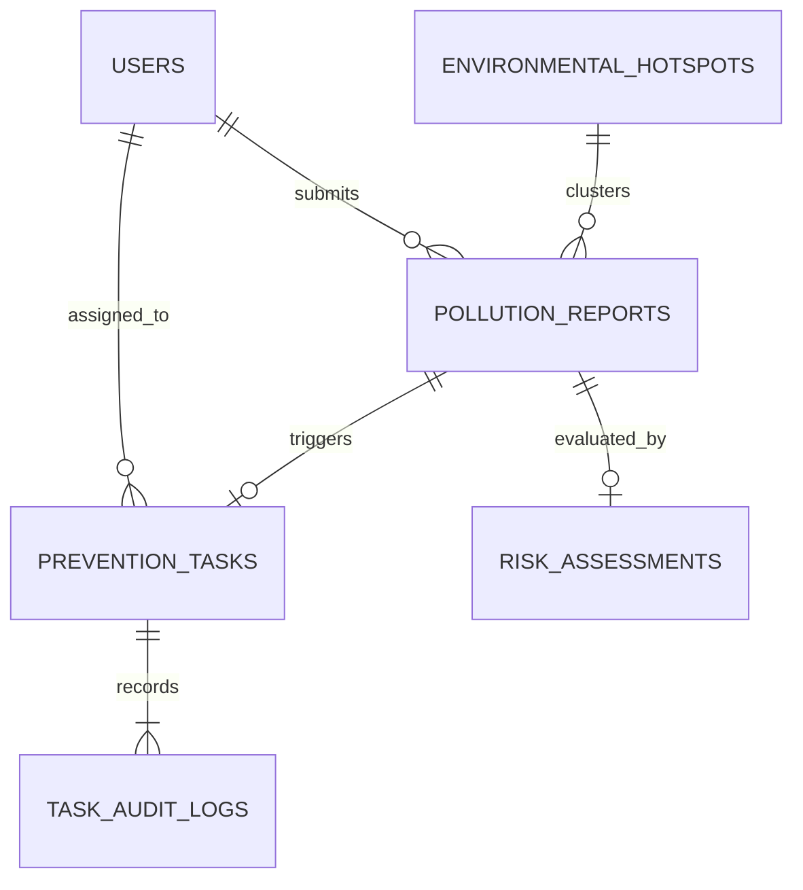

# EcoShield AI — Database Schema & Data Models

This document defines the formal data contracts, Cloud Firestore collection schemas, PostgreSQL / Supabase DDL specifications, access control models, Row Level Security (RLS) policies, and validation rules used by **EcoShield AI**.

---

## 1. System Collections Overview



---

## 2. Document Schema Specifications

### `users` / `profiles` Entity
Stores user identity, roles, EcoPoints, and verified civic achievement badges.

| Field | Type | Validation / Constraints | Description |
| :--- | :--- | :--- | :--- |
| `id` | `string` / `UUID` | Unique UID (`auth.users.id` or UUID) | Unique user identifier |
| `email` | `string` | Valid RFC 5322 email string | Primary communication address |
| `displayName` | `string` | Min 2, max 60 chars | Contributor public name |
| `role` | `string` | Enum: `'citizen' \| 'field_worker' \| 'admin'` | Strict Role-Based Access Level |
| `ecoPoints` | `number` | Integer $\ge 0$ | Cumulative gamification balance |
| `badges` | `string[]` | Array of strings | Earned achievement tokens |
| `department` | `string?` | Optional string | Municipal unit or NGO affiliation |
| `reportsSubmitted`| `number` | Integer $\ge 0$ | Total reports originated |
| `tasksCompleted` | `number` | Integer $\ge 0$ | Total field tasks verified |
| `isDeactivated` | `boolean?` | Default `false` | Administrative freeze flag |

### `reports` / `pollution_reports` Entity
Contains geotagged citizen and field incident observations across the 9 pollution categories.

| Field | Type | Validation / Constraints | Description |
| :--- | :--- | :--- | :--- |
| `id` | `string` | Pattern `REP-YYYY-XXXX` | Human-readable tracking ID |
| `category` | `string` | Enum: `air`, `water`, `soil`, `noise`, `light`, `thermal`, `plastic`, `radioactive`, `visual` | Environmental domain |
| `title` | `string` | Min 5, max 120 chars | Incident headline |
| `description` | `string` | Min 20, max 2000 chars | Comprehensive observation narrative |
| `location` | `map` / `columns` | Contains `lat: number`, `lng: number`, `addressName: string` | Precise geographic coordinates |
| `severity` | `number` | Integer: 1 (Minor) to 5 (Critical Emergency) | Ground observer rating |
| `evidenceType`| `string` | Enum: `'photo' \| 'document' \| 'observation'` | Format of supporting evidence |
| `evidenceNotes`| `string?`| Descriptive text | Visual documentation summary |
| `status` | `string` | Enum: `submitted`, `under_review`, `verified`, `action_assigned`, `action_taken`, `resolved`, `rejected` | Lifecycle state |
| `reporterId` | `string` / `UUID` | References `profiles.id` | Document creator UID |
| `reporterName`| `string` | Masked if `isAnonymous = true` | Display author name |
| `isAnonymous` | `boolean` | Default `false` | Privacy preservation toggle |
| `verifiedBy` | `string?` | Name of reviewing Officer / Admin | Verification signatory |
| `verificationNotes`| `string?`| Reviewer commentary | Ground inspection details |
| `linkedTaskId` | `string?` | References `tasks.id` | Spawned prevention work order |
| `createdAt` | `timestamp`| ISO 8601 string / TIMESTAMPTZ | Creation timestamp |
| `updatedAt` | `timestamp`| ISO 8601 string / TIMESTAMPTZ | Last state change |

### `tasks` / `prevention_tasks` Entity
Prevention Command Center work orders dispatching mitigation crews.

| Field | Type | Validation / Constraints | Description |
| :--- | :--- | :--- | :--- |
| `id` | `string` | Pattern `TSK-PREV-XXX` | Work order ticket number |
| `reportId` | `string?` | References `reports.id` | Target incident report |
| `title` | `string` | Min 5, max 140 chars | Directive summary |
| `description` | `string` | Min 20 chars | Operational mitigation requirements |
| `category` | `string` | Enum: 9 pollution categories | Target hazard type |
| `priority` | `string` | Enum: `'low' \| 'medium' \| 'high' \| 'critical'` | Urgency classification |
| `status` | `string` | Enum: `'assigned' \| 'in_progress' \| 'completed' \| 'verified'` | Execution progress |
| `location` | `map` / `columns` | `lat`, `lng`, `addressName` | Site coordinates |
| `riskScore` | `number` | Integer 0 to 100 | AI Risk Engine evaluated score |
| `riskLevel` | `string` | Enum: `'low' \| 'moderate' \| 'high' \| 'critical'` | Risk tier |
| `assignedTo` | `map?` / `columns` | `{ id: string, name: string, role: string }` | Assigned field officer |
| `deadline` | `timestamp`| ISO 8601 string / TIMESTAMPTZ | Target completion date |
| `beforeEvidence`| `string?`| Baseline notes / photo proof | Intake condition |
| `afterEvidence` | `string?`| Mitigation notes / photo proof | Post-intervention condition |
| `actionSummary` | `string?`| Field officer summary | Work log |
| `reviewerNotes` | `string?`| Senior inspector comments | Sign-off remarks |
| `verifiedBy` | `string?` | Inspector name | Audit sign-off |
| `verifiedAt` | `timestamp?`| ISO 8601 string / TIMESTAMPTZ | Verification timestamp |
| `auditTrail` | `array` / `table` | Array or rows in `task_audit_logs` | Append-only execution history |

### `hotspots` Collection
Persistent geographic risk clusters and vulnerable infrastructure points.

| Field | Type | Validation / Constraints | Description |
| :--- | :--- | :--- | :--- |
| `id` | `string` | Unique hotspot identifier | Geographic zone ID |
| `name` | `string` | Human-readable sector name | Area title |
| `category` | `string` | Enum: 9 pollution categories | Primary vulnerability |
| `coordinates` | `map` | `lat`, `lng`, `addressName` | Centroid coordinates |
| `currentRiskScore`| `number` | Integer 0-100 | Normalized risk metric |
| `currentRiskLevel`| `string` | Enum: `'low' \| 'moderate' \| 'high' \| 'critical'` | Risk classification |
| `activeReportsCount`| `number` | Count of linked active reports | Cluster density |
| `description` | `string` | Vulnerability notes | Environmental sensitivity |
| `lastInspectedAt` | `timestamp`| ISO 8601 string | Recency of on-site survey |
| `status` | `string` | Enum: `active_monitoring`, `mitigation_active`, `cleared` | Operational status |

---

## 3. Production PostgreSQL & Supabase DDL Specification (Step 12.2)

For production deployments using the ₹0 Free Tier of Supabase PostgreSQL, execute this complete, self-contained SQL migration in the **Supabase SQL Editor**:

```sql
-- =================================================================
-- EcoShield AI — Production PostgreSQL / Supabase Schema (₹0 Free Tier)
-- =================================================================

-- 1. Users Profile Table (Extends Supabase auth.users)
CREATE TABLE IF NOT EXISTS public.profiles (
  id UUID REFERENCES auth.users ON DELETE CASCADE PRIMARY KEY,
  email TEXT UNIQUE NOT NULL,
  display_name TEXT NOT NULL,
  role TEXT NOT NULL DEFAULT 'citizen' CHECK (role IN ('citizen', 'field_worker', 'admin')),
  eco_points INTEGER NOT NULL DEFAULT 50,
  badges TEXT[] NOT NULL DEFAULT '{"Eco Pioneer"}',
  department TEXT,
  reports_submitted INTEGER NOT NULL DEFAULT 0,
  tasks_completed INTEGER NOT NULL DEFAULT 0,
  is_deactivated BOOLEAN NOT NULL DEFAULT false,
  created_at TIMESTAMPTZ NOT NULL DEFAULT timezone('utc'::text, now()),
  updated_at TIMESTAMPTZ NOT NULL DEFAULT timezone('utc'::text, now())
);

-- Enable Row Level Security
ALTER TABLE public.profiles ENABLE ROW LEVEL SECURITY;

CREATE POLICY "Public profiles are viewable by authenticated users" 
ON public.profiles FOR SELECT TO authenticated USING (true);

-- Anti-Self-Escalation Check: Users can only update their own display name, NOT their role
CREATE POLICY "Users can update own display profile" 
ON public.profiles FOR UPDATE TO authenticated USING (auth.uid() = id)
WITH CHECK (
  auth.uid() = id 
  AND role = (SELECT role FROM public.profiles WHERE id = auth.uid())
);

-- 2. Pollution Reports Table
CREATE TABLE IF NOT EXISTS public.pollution_reports (
  id TEXT PRIMARY KEY DEFAULT 'REP-' || to_char(now(), 'YYYY') || '-' || substr(md5(random()::text), 1, 6),
  category TEXT NOT NULL CHECK (category IN ('air','water','soil','noise','light','thermal','plastic','radioactive','visual')),
  title TEXT NOT NULL CHECK (char_length(title) >= 5),
  description TEXT NOT NULL CHECK (char_length(description) >= 10),
  lat DOUBLE PRECISION NOT NULL CHECK (lat BETWEEN -90 AND 90),
  lng DOUBLE PRECISION NOT NULL CHECK (lng BETWEEN -180 AND 180),
  address_name TEXT,
  severity INTEGER NOT NULL CHECK (severity BETWEEN 1 AND 5),
  status TEXT NOT NULL DEFAULT 'submitted' CHECK (status IN ('submitted','under_review','verified','action_assigned','in_progress','action_taken','resolved','rejected')),
  reporter_id UUID REFERENCES public.profiles(id) ON DELETE SET NULL,
  reporter_name TEXT NOT NULL,
  is_anonymous BOOLEAN NOT NULL DEFAULT false,
  evidence_url TEXT,
  evidence_type TEXT CHECK (evidence_type IN ('photo','document','observation')),
  evidence_notes TEXT,
  verified_by TEXT,
  verification_notes TEXT,
  linked_task_id TEXT,
  is_demo BOOLEAN NOT NULL DEFAULT false,
  observed_at TIMESTAMPTZ NOT NULL DEFAULT timezone('utc'::text, now()),
  created_at TIMESTAMPTZ NOT NULL DEFAULT timezone('utc'::text, now()),
  updated_at TIMESTAMPTZ NOT NULL DEFAULT timezone('utc'::text, now())
);

ALTER TABLE public.pollution_reports ENABLE ROW LEVEL SECURITY;

CREATE POLICY "Anyone can view reports" 
ON public.pollution_reports FOR SELECT USING (true);

CREATE POLICY "Authenticated users can submit reports" 
ON public.pollution_reports FOR INSERT TO authenticated 
WITH CHECK (auth.uid() = reporter_id);

CREATE POLICY "Admins and field workers can update status" 
ON public.pollution_reports FOR UPDATE TO authenticated 
USING (
  (SELECT role FROM public.profiles WHERE id = auth.uid()) IN ('admin', 'field_worker')
  OR (reporter_id = auth.uid() AND status = 'submitted')
);

-- 3. Prevention Tasks Table
CREATE TABLE IF NOT EXISTS public.prevention_tasks (
  id TEXT PRIMARY KEY DEFAULT 'TSK-PREV-' || substr(md5(random()::text), 1, 6),
  report_id TEXT REFERENCES public.pollution_reports(id) ON DELETE SET NULL,
  title TEXT NOT NULL,
  description TEXT NOT NULL,
  category TEXT NOT NULL,
  priority TEXT NOT NULL CHECK (priority IN ('low','medium','high','critical')),
  status TEXT NOT NULL DEFAULT 'assigned' CHECK (status IN ('pending','assigned','in_progress','completed','verified')),
  lat DOUBLE PRECISION NOT NULL,
  lng DOUBLE PRECISION NOT NULL,
  address_name TEXT,
  risk_score INTEGER NOT NULL CHECK (risk_score BETWEEN 0 AND 100),
  risk_level TEXT NOT NULL CHECK (risk_level IN ('low','moderate','high','critical')),
  assigned_to_id UUID REFERENCES public.profiles(id) ON DELETE SET NULL,
  assigned_to_name TEXT,
  assigned_to_role TEXT,
  deadline TIMESTAMPTZ NOT NULL,
  before_evidence TEXT,
  after_evidence TEXT,
  action_summary TEXT,
  reviewer_notes TEXT,
  correction_notes TEXT,
  verified_by TEXT,
  verified_at TIMESTAMPTZ,
  is_demo BOOLEAN NOT NULL DEFAULT false,
  created_at TIMESTAMPTZ NOT NULL DEFAULT timezone('utc'::text, now()),
  updated_at TIMESTAMPTZ NOT NULL DEFAULT timezone('utc'::text, now())
);

ALTER TABLE public.prevention_tasks ENABLE ROW LEVEL SECURITY;

CREATE POLICY "Authenticated users can view prevention tasks" 
ON public.prevention_tasks FOR SELECT TO authenticated USING (true);

CREATE POLICY "Admins and workers can manage tasks" 
ON public.prevention_tasks FOR ALL TO authenticated 
USING ((SELECT role FROM public.profiles WHERE id = auth.uid()) IN ('admin', 'field_worker'));

-- 4. Immutable Audit Log Table
CREATE TABLE IF NOT EXISTS public.task_audit_logs (
  id UUID PRIMARY KEY DEFAULT gen_random_uuid(),
  task_id TEXT REFERENCES public.prevention_tasks(id) ON DELETE CASCADE,
  actor_id UUID REFERENCES public.profiles(id) ON DELETE SET NULL,
  actor_name TEXT NOT NULL,
  action TEXT NOT NULL,
  details TEXT NOT NULL,
  timestamp TIMESTAMPTZ NOT NULL DEFAULT timezone('utc'::text, now())
);

ALTER TABLE public.task_audit_logs ENABLE ROW LEVEL SECURITY;

CREATE POLICY "Audit logs viewable by authenticated users" 
ON public.task_audit_logs FOR SELECT TO authenticated USING (true);

CREATE POLICY "Audit logs append-only for authenticated users" 
ON public.task_audit_logs FOR INSERT TO authenticated WITH CHECK (true);

-- Note: No UPDATE or DELETE policy exists on audit logs (Enforcing cryptographic/database immutability).

-- 5. Trigger: Automated Profile Creation for New Users
CREATE OR REPLACE FUNCTION public.handle_new_user()
RETURNS trigger AS $$
BEGIN
  INSERT INTO public.profiles (id, email, display_name, role)
  VALUES (
    new.id,
    new.email,
    COALESCE(new.raw_user_meta_data->>'display_name', split_part(new.email, '@', 1)),
    'citizen' -- Default role is ALWAYS citizen. Client-side self-escalation is strictly prevented.
  );
  RETURN new;
END;
$$ LANGUAGE plpgsql SECURITY DEFINER;

DROP TRIGGER IF EXISTS on_auth_user_created ON auth.users;
CREATE TRIGGER on_auth_user_created
  AFTER INSERT ON auth.users
  FOR EACH ROW EXECUTE FUNCTION public.handle_new_user();

-- 6. Server-Side Administrative Provisioning (Executed strictly by Database Superuser)
-- Securely designates Ganesh Reddy as initial municipal platform administrator
CREATE OR REPLACE FUNCTION public.provision_initial_admin(admin_email TEXT, admin_name TEXT)
RETURNS void AS $$
BEGIN
  UPDATE public.profiles
  SET role = 'admin',
      display_name = admin_name,
      updated_at = timezone('utc'::text, now())
  WHERE email = admin_email;
END;
$$ LANGUAGE plpgsql SECURITY DEFINER;
```

---

## 4. Server-Side Initial Admin Provisioning Procedure

To designate **Ganesh Reddy** (`ganeshjalla2006@gmail.com`) as the municipal administrator:

1. User registers via Supabase Auth and completes email verification.
2. The automatic trigger `on_auth_user_created` provisions a default `citizen` profile.
3. The Database Administrator executes this trusted SQL statement in the Supabase SQL editor:

```sql
UPDATE public.profiles
SET role = 'admin',
    display_name = 'Ganesh Reddy',
    updated_at = timezone('utc'::text, now())
WHERE email = 'ganeshjalla2006@gmail.com';
```

This guarantees that administrative authority is granted solely through an authorized server-side database process, and never trusted from frontend requests.

---

## 5. Cloud Firestore Security Rules Summary (Firebase Option)

The provided `firestore.rules` enforces authorization when using Firebase:
1. **Public Read-Only Access:** Reports and hotspots are publicly queryable for open community awareness.
2. **Citizen Submission:** Any authenticated user can create a report under their own UID, and cannot modify other users' reports.
3. **Field Worker Execution:** Status updates to `in_progress` and `completed` require `role == 'field_worker'` or `'admin'`.
4. **Admin Sign-Off:** Task verification, user role elevation, and hotspot deletion strictly mandate `role == 'admin'`.
5. **No Client Role Tampering:** User documents prevent client-side mutation of the `role` field.
